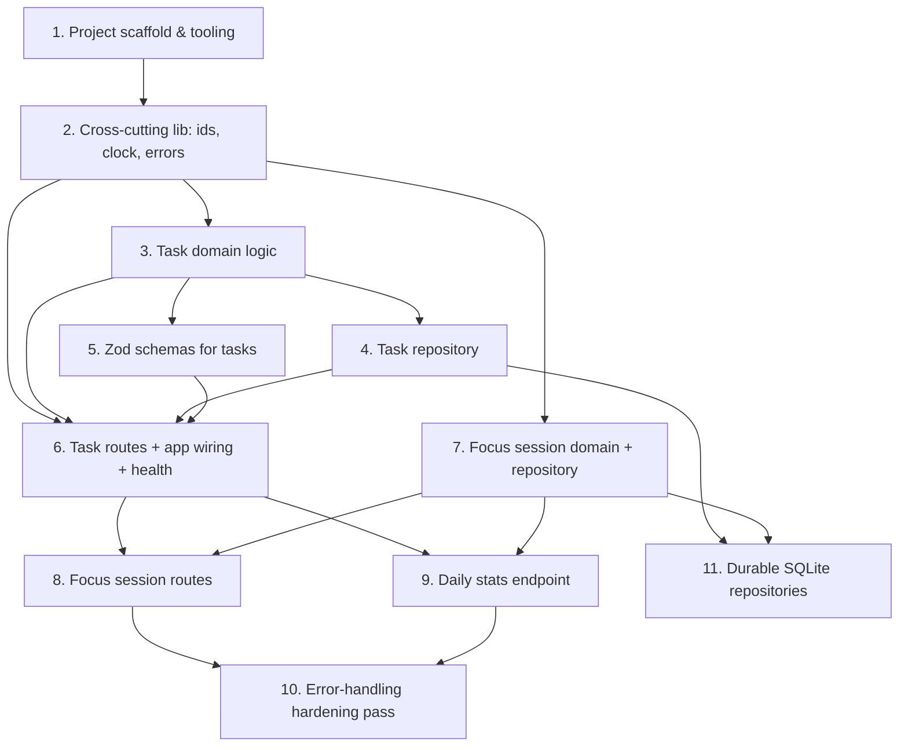

# Implementation Plan

## Overview

Implementation plan for FocusFlow. Each task is small, independently verifiable, and cites
the requirements it satisfies. Check a box when the task is implemented **and** its tests
pass.

This plan follows the layering in `design.md`: foundation and tooling first, then the pure
task domain, then repositories, schemas, and routes, and finally focus sessions, stats, and
hardening. Storage is deliberately kept behind interfaces so the durable (SQLite) swap is a
clean, isolated future task.

> How to run a task in Kiro: open this file, click **Start task** above an unchecked item,
> and Kiro implements just that slice against the spec. Review, then move to the next.

## Tasks

- [x] 1. Project scaffold & tooling
  - Initialize `package.json` (ESM), `tsconfig.json` (strict), `vitest.config.ts`, `.gitignore`.
  - Add scripts: `dev`, `build`, `test`, `test:watch`, `lint`.
  - _NFR: no native deps; installs cross-platform._

- [x] 2. Cross-cutting lib: ids, clock, errors
  - `lib/clock.ts` (injectable `Clock`), `lib/id.ts` (unique ids), `lib/errors.ts`
    (tagged `AppError` + factory helpers and the error-code catalog).
  - _Requirements: 5.3, 6.1._

- [x] 3. Task domain logic (pure)
  - `domain/task.ts`: `createTask`, `normalizeTags`, `applyUpdate`, `completeTask`
    (idempotent), status typing.
  - Unit tests for tag normalization and idempotent completion.
  - _Requirements: 1.1, 1.4, 3.1, 3.2, 3.3._

- [x] 4. Task repository
  - `repositories/task-repository.ts` interface + `in-memory-task-repository.ts`.
  - _Requirements: 2.1, 2.5._

- [x] 5. Zod schemas for tasks
  - `schemas/task-schemas.ts`: create/update bodies, list query, id param.
  - _Requirements: 1.2, 1.3, 2.2, 2.3._

- [x] 6. Task routes + app wiring + error handling + health
  - `app.ts` (`buildApp(deps)`), `routes/task-routes.ts`, `routes/health-routes.ts`,
    central `setErrorHandler` + `setNotFoundHandler`, `server.ts`.
  - Integration tests via `app.inject()` for every task endpoint + health + unknown route.
  - _Requirements: 1.1–1.4, 2.1–2.5, 3.1–3.5, 6.1–6.4._

- [x] 7. Focus session domain + repository
  - `domain/session.ts` (`startSession`, `stopSession` with >=1 min rounding),
    `SessionRepository` + in-memory impl, active-session lookup.
  - Unit tests for duration rounding and the single-active-session rule.
  - _Requirements: 4.1, 4.3, 4.4._

- [x] 8. Focus session routes
  - `routes/session-routes.ts`: `POST /tasks/:id/sessions`, `POST /sessions/active/stop`.
  - Integration tests for start/stop plus `409` conflicts and `404` for unknown task.
  - _Requirements: 4.1–4.5._

- [x] 9. Daily stats endpoint
  - `domain/stats.ts` (UTC window math), `routes/stats-routes.ts` (`GET /stats?date=`).
  - Tests with a fixed clock asserting exact counts and minutes.
  - _Requirements: 5.1–5.4._

- [x] 10. Error-handling hardening pass
  - Verify 500s never leak stacks; confirm envelope on every error path.
  - _Requirements: 6.1, 6.3._

- [x] 11. (Stretch) Durable SQLite repositories
  - Implement `SqliteTaskRepository` / `SqliteSessionRepository` behind existing interfaces
    using the built-in `node:sqlite` (`DatabaseSync`); switch wiring in `server.ts` only.
    Repos take a `DatabaseSync` via `import type` (no runtime dep); `repositories/sqlite.ts`
    holds the one runtime import. Bump `engines` to `>=22`; CI runs 22 + 24 with
    `NODE_OPTIONS=--experimental-sqlite`. Gated tests assert CRUD/ordering parity with in-memory.
  - Demonstrates the storage swap the interfaces enable (see design.md "Durable persistence").
  - _Requirements: NFR; enables future persistence._

## Task Dependency Graph

Dependencies point from a prerequisite task to the task that builds on it. Tasks with no
inbound edges can be started once their prerequisites are done.



The same dependencies expressed as execution **waves**. Each wave lists the tasks whose
prerequisites are all satisfied by earlier waves, so every task within a wave can be picked
up in parallel. Waves are derived directly from the edges above (a task's wave is one past
the latest wave of any prerequisite).

```json
{
  "waves": [
    {
      "wave": 1,
      "tasks": [1],
      "rationale": "No prerequisites; project scaffold & tooling bootstraps everything."
    },
    {
      "wave": 2,
      "tasks": [2],
      "rationale": "Cross-cutting lib depends only on the scaffold."
    },
    {
      "wave": 3,
      "tasks": [3, 7],
      "rationale": "Task domain and focus-session domain both build on the lib and are independent of each other."
    },
    {
      "wave": 4,
      "tasks": [4, 5],
      "rationale": "Task repository and Zod schemas both depend on the task domain."
    },
    {
      "wave": 5,
      "tasks": [6, 11],
      "rationale": "Task routes need domain + repository + schemas; the SQLite stretch needs the task repository and session domain."
    },
    {
      "wave": 6,
      "tasks": [8, 9],
      "rationale": "Session routes and the stats endpoint both build on task routes and the session domain."
    },
    {
      "wave": 7,
      "tasks": [10],
      "rationale": "Error-handling hardening runs last, over the session and stats routes."
    }
  ]
}
```

## Notes

- **All 11 tasks are implemented and tested** (68 tests passing across domain, routes, and the
  SQLite repositories). Tasks 1–6 are the foundation (task CRUD, health, error handling);
  tasks 7–10 add focus sessions, daily stats, and the hardening pass; task 11 swaps in the
  durable `node:sqlite` repositories behind the existing interfaces (wiring in `server.ts` only).
- This spec is therefore **complete**. New capabilities start a new spec under `.kiro/specs/`
  (copy `_TEMPLATE/`), per the golden rule — the `spec-authoring` skill walks through it.
- Each task cites the requirement ids it satisfies so any change can be traced from
  requirement → design → implementation task → test.
